# Topic 4: Data Quality Audit and Responsible Data Assessment

AI Incident and Risk Explorer · SAIA3113 AI Engineering

**Name:** Tey Yu Yang · **Student ID:** A24AI0122

## A. Project data

AI Incident and Risk Explorer is a document-grounded assistant that answers questions about real AI incidents and risks and cites a source record for every claim. Two requirements matter most for the data: FR4, every claim must show a record ID and a working source link; and FR3, each incident must be mapped to a domain in the MIT risk taxonomy. These need two tables: a snapshot of real incidents and a risk taxonomy, both structured tables (CSV and Excel) with text as their main content. Both were prepared in Week 3 with SHA-256 lineage manifests, and this audit checks the prepared tables only.

|  | S01: AI Incident Database | S02: MIT AI Risk Repository |
|---|---|---|
| Version used | Weekly snapshot, 2026-11-02 | Version 4, updated 03 December 2025 |
| Prepared table | `prepared_incidents.csv`: 1,786 rows, 8 columns | `prepared_risks.csv`: 2,574 rows, 9 columns |
| Used for | Answering, finding similar cases, citing (FR1, FR2, FR4) | Classifying incidents into risk domains (FR3) |
| Licence | CC BY-SA 4.0; report contents keep their own rights, so `reports.csv` is not used | CC BY 4.0 |
| Citation link | `https://incidentdatabase.ai/cite/<id>` built from the incident ID | Risk record ID |

**If data is missing.** An incident without an ID cannot be cited, so FR4 fails. A risk record without a description or domain cannot be used to classify incidents, so FR3 is affected.

**What was inspected.** All 1,786 and 2,574 rows were checked by code. A seeded sample of 19 incident records and 20 risk records (15 random each, plus unusual ones such as the oldest incident and rows sharing an ID) was drawn, and 20 of them, including the unusual ones, are listed in the appendix. Three incident records were also compared with the live AIID pages by hand. Sample findings are reported as sample findings, and full-table counts as counts for the whole dataset.

## B. Five quality dimensions

The risk table (S02) has the main problems: over a third of its rows lack a description or domain, and five IDs are reused. The incident table (S01) passed every check run on it. Counts cover the whole table unless marked as a sample.

| Dimension | Finding | Evidence |
|---|---|---|
| Completeness | S01 has no missing values in its required fields. S02 does: 36.0% of rows have no description and 37.8% have no domain. | S01: 0 missing of 1,786. S02: 926 and 972 missing of 2,574. The first listed rows (such as `01.01.00.a`) have a category but no text, so they may be sub-entries or placeholders; this is unconfirmed. Some descriptions are just "-" (for example `62.31.00`), which the count does not catch. |
| Consistency | S01 is consistent. S02 domains agree with their subdomains, but its ID formats are mixed. | S01: 0 unparseable dates, 0 dates after the snapshot, all 1,786 links match their ID. S02: 0 domain/subdomain mismatches in 1,600 rows that have both; only 1,908 of 2,574 IDs follow `dd.dd.dd`, the rest look like `01.01.00.a` or `60.01.01a`. |
| Accuracy | The three S01 records checked match the live AIID pages. This says nothing about the other 1,783, or about whether a report's claims are true. | Records 550, 1158 and 1362: title and date identical on the website. S02 was not compared with its source. |
| Timeliness | S01 is current; S02 is older than S01. | Latest incident 2026-10-30, three days before the 2026-11-02 snapshot. MIT version dated 2025-12-03, about 11 months older, so newer kinds of incident may be missing from the taxonomy. |
| Uniqueness | S01 has no duplicates. S02 has no copied rows but reuses five IDs. | S01: 0 duplicate rows, IDs or normalised titles. S02: IDs `49.01.02` and `62.31.00` to `62.31.03` each appear twice with different text or category; 98 descriptions repeat. They look like different entries sharing an ID, not copies; this needs checking against the source. |

**Impact.** Missing S02 descriptions and domains leave 44.4% of risk rows unusable for classification (FR3). Reused IDs mean a citation could point to the wrong risk record (FR4), and the mixed ID formats make joins and filters fragile. The age of S02 means newer kinds of incidents may be classified less well. No problem was found in S01.

## C. Validation rules

Both rules were run on the full tables. Rule 1 passes for S01 and fails for S02; Rule 2 fails for S02, with 44.4% of rows affected.

|  | Rule 1: unique, non-empty ID | Rule 2: description and domain present |
|---|---|---|
| Problem it detects | A record that cannot be cited, or a citation that could point to two records (FR4, RAI1) | A risk record that cannot be retrieved by meaning or placed in a domain (FR3) |
| Condition checked | `record_id` is not empty and appears once in the table | `description` is not empty and `domain` is one of the 7 MIT domains |
| Result | S01: PASS (0 empty, 0 duplicates in 1,786). S02: FAIL, 0 empty but 5 duplicated IDs: `49.01.02`, `62.31.00`, `62.31.01`, `62.31.02`, `62.31.03` | S02: FAIL. 1,430 of 2,574 rows pass (55.6%). 926 lack a description, 972 lack a domain, 754 lack both, 1,144 fail at least one |
| Follow-up action | Compare each pair in the MIT source. If they are different entries, make the ID unique by adding the category; if not, record which row is kept and why | Mark failing rows `needs_review` and keep them. Check whether they are structural rows, then decide which are left out of retrieval and classification |

**Why human review, not auto-deletion.** Deleting the 1,144 failing rows would remove 44.4% of the risk table in one step, and the output shows many of them hold a category name even without text, so they may be part of the taxonomy's structure. The five repeated IDs have different text, so dropping the second row of each pair would silently lose a real entry. A reviewer can tell a placeholder from a genuine gap, and the flag keeps the problem visible for the later steps of the pipeline.

## D. Coverage and bias

The incident data leans heavily towards recent years and, by a rough measure, towards the United States. Neither table has a region field, so the region is estimated from keywords and should be read as an indication only.

| Category | What the data shows | Bias risk | Effect on the assistant |
|---|---|---|---|
| Time period (S01) | 60.0% of the 1,786 incidents are from the last three years. Incidents per year: 45 (2019), 91, 80, 109, 179, 313, 463 (2025), 296 (2026, to 30 October). The earliest is from 1983. | Historical and reporting bias: the rise may reflect more reporting and cataloguing, not only more incidents. | Questions about early AI failures have few records to retrieve, and answers about trends could overstate recent growth. |
| Region (S01) | Keyword matches in title and description, out of 1,786: United States 134, China 60, United Kingdom 48, India 36, Africa 25, Europe/EU 14, Latin America 14, Malaysia 7. Most records name no region at all. | Representation bias: AIID reports come mainly from widely covered, English-language news, and the keyword method itself under-counts places named differently. | Questions about Malaysia or other under-represented places may get "not found", which the assistant would present as no evidence rather than no coverage. |

**Is the evidence sufficient?** For recent incidents, yes: 463 records for 2025 and 60.0% of the table from the last three years. For earlier periods, less so: 2019 has 45 records. For the region, the US has 134 keyword matches, which is plenty, but Malaysia has only 7, which is probably too few to test questions about Malaysia well. The keyword method may under-count, so this is a judgement from a rough measure.

S02 is also uneven: of the rows that have a domain, AI System Safety (422) is the largest and Misinformation (80) the smallest. Because 972 rows have no domain, this reflects the labelled rows only.

**Could the assistant do better for some cases than others?** Probably yes: it has more records on recent and US-related incidents than on older or Malaysian ones, so it may answer those better. This is a risk, not a confirmed effect. To test it, write 10 questions for each group (recent versus before 2020; US versus Malaysia) and compare how often the assistant finds and cites a relevant record.

## E. Responsible data practices

The main risks are licence terms and sensitive content, since both sources are public but not free of obligations.

**Source and traceability.** Both tables come from the public sources named in section A. Every incident row links to its AIID page through its ID, and the manifests' SHA-256 fingerprints tie each prepared file to the raw download it came from.

**Permission.** Yes, on the published licences: both sources allow reuse with credit, and the share-alike term of the AIID licence applies to the prepared incident table. This is my reading of the licence terms, not legal advice, and it should be rechecked if the data is ever redistributed.

- **Licensing.** The AIID snapshot is CC BY-SA 4.0, so the prepared incident table is credited to AIID and shared under the same licence; report contents keep their own rights, so `reports.csv` is not used. The MIT repository is CC BY 4.0 and is credited to MIT.
- **Personal data.** A pattern scan of the incident text found 1 row with an email-like pattern and none with a phone number. The row (incident 1680) was opened and is a software package name with a version number (`cline@2.3.0`), not an email address. The scan only finds emails and phone numbers; it cannot find names or other personal details, so incident descriptions will still be shown with care.
- **Sensitive content.** 223 incidents (12.5%) contain words linked to sensitive topics, and the sample includes a record about sexual images of minors. These records will be shown by title and source link, with the full description kept out of the displayed answer.
- **Allegations.** Many titles say "allegedly" or "reportedly". Answers will repeat that wording and will not state an allegation as fact.

**Governance statement.** The project owner is responsible for this data. Every prepared table is tied to its raw source by SHA-256 fingerprints and a manifest. Each snapshot refresh is followed by a rerun of this audit before the data is used, and any record that fails a rule is flagged for review, not deleted. Raw files, passwords and keys are never committed to the repository.

## F. Quality gate decision

**Decision: GO WITH CONDITIONS.** The incident table (S01) passed every check and can be used. The risk table (S02) cannot be used as it stands, because 44.4% of its rows fail Rule 2 and five IDs are reused, but its problems are specific and can be contained. A full HOLD is not needed, and a plain GO would ignore the S02 results. Until the improvements below are done, classification (FR3) should use only the 1,430 S02 rows that pass Rule 2.

**Priority improvements**

1. **Review the 1,144 S02 rows that fail Rule 2.** Check in the MIT source whether they are structural rows or real gaps, flag them `needs_review`, and decide which ones to leave out of the index. Success means every failing row has a recorded decision.
2. **Make S02 record IDs unique.** Compare the five reused IDs (`49.01.02`, `62.31.00` to `62.31.03`) with the source and add a key so each citation points to one record. Success means Rule 1 passes for S02.

## Appendix: inspected sample and limitations

| Source | Record ID | Date or category | Why it was inspected / what it shows |
|---|---|---|---|
| S01 | 550 | 2023-03-17 | Random. Title and date match the live page. |
| S01 | 1158 | 2025-07-17 | Random. Title and date match the live page. |
| S01 | 1362 | 2026-01-10 | Random. Title and date match the live page. |
| S01 | 300 | 2022-01-15 | Random. No problem seen in the displayed fields. |
| S01 | 1073 | 2025-04-15 | Random. No problem seen in the displayed fields. |
| S01 | 694 | 2023-04-25 | Random. No problem seen in the displayed fields. |
| S01 | 1740 | 2026-10-03 | Random. No problem seen in the displayed fields. |
| S01 | 27 | 1983-09-26 | Edge case: the oldest incident, "Nuclear False Alarm". |
| S01 | 60 | 2017-04-25 | Edge case: a very short title, "FaceApp Racial Filters". |
| S01 | 1795 | 2026-10-30 | Edge case: the newest incident. |
| S01 | 899 | 2024-12-17 | Sensitive topic: chatbots allegedly emulating school shooters. |
| S01 | 1266 | 2025-11-10 | Sensitive topic: sexual images of minors. Description not reproduced here. |
| S02 | 01.00.00 | none | Edge case: no category, description, domain or subdomain. |
| S02 | 01.01.00.a | Type 1: Diffusion of responsibility | Category only; no description or domain. |
| S02 | 49.01.02 (two rows) | Malicious Use Risks | Same ID, different text and subdomain (4.1 and 4.2). |
| S02 | 62.31.00 (two rows) | Societal / Financial Impacts | Same ID; description is "-" and domain is empty. |
| S02 | 60.01.01a | Risks from malicious use | ID with a trailing letter; no domain. |
| S02 | 24.09.02 | Cooperation | Complete record, domain 7. |
| S02 | 65.06.01 | Training Data Risks (Accuracy) | Complete record, domain 7, subdomain 7.3. |
| S02 | 21.02.01 | Model-level risk | Complete record, domain 1, subdomain 1.1. |

**Limitations**

- The sample is for illustration. It was drawn with a fixed random seed and includes chosen edge cases, so it is not representative; the whole-table counts above do not depend on it.
- Accuracy was checked for 3 S01 records only. S02 was not compared with its source, and the audit does not test whether a report's claims are true.
- The cause of the missing S02 descriptions (structural rows or real gaps) is not confirmed.
- Region figures come from keyword matching, not a region field, and the personal-data scan checks only for email and phone patterns.

## Evidence screenshots

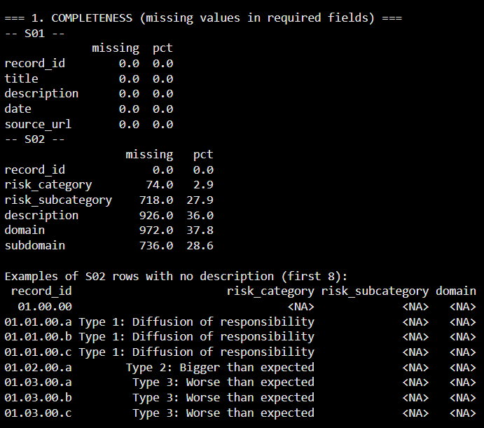

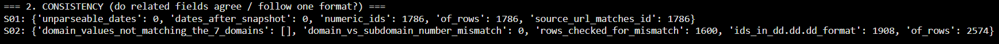

*Figure 1: Colab output for completeness and consistency*

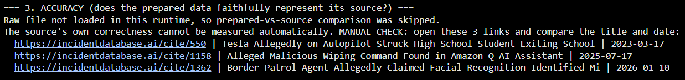

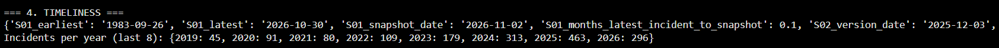

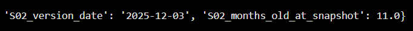

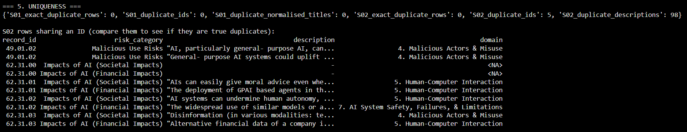

*Figure 2: Colab output for accuracy, timeliness and uniqueness*

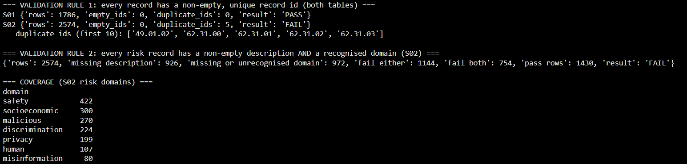

*Figure 3: Colab output for the two validation rules*

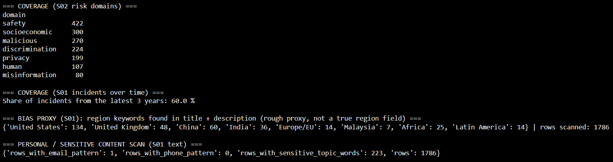

*Figure 4: Colab output for coverage and bias, and the personal and sensitive content scan*

| Incident | Title | Incident stats |
|---|---|---|
| 550 | 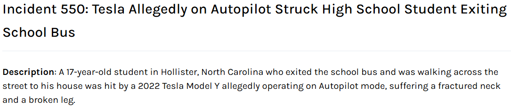 | 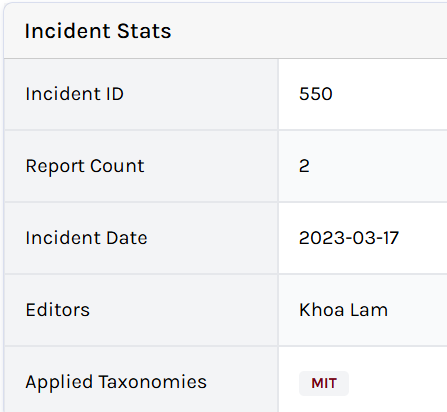 |
| 1158 | 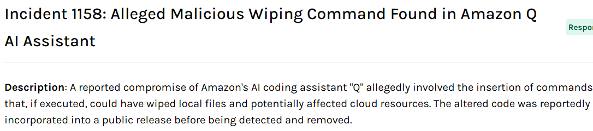 | 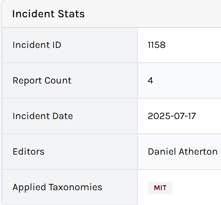 |
| 1362 | 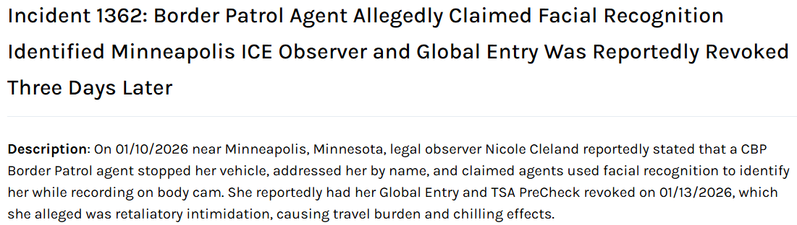 | 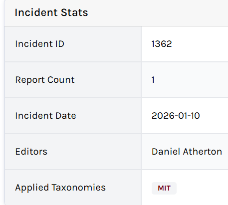 |

*Figure 5: Live AIID pages for incidents 550, 1158 and 1362*

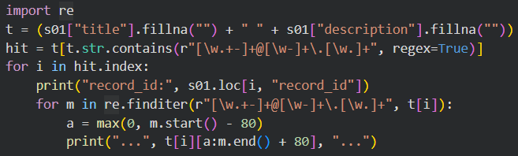

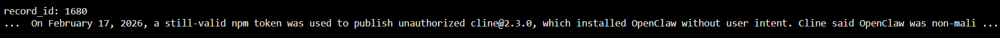

*Figure 6: Check of the one email-like row found by the personal-data scan (Figure 4)*
